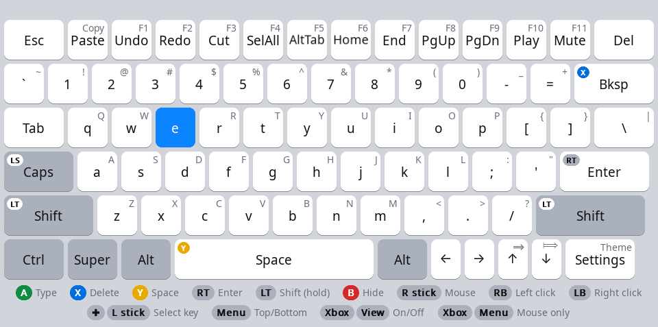
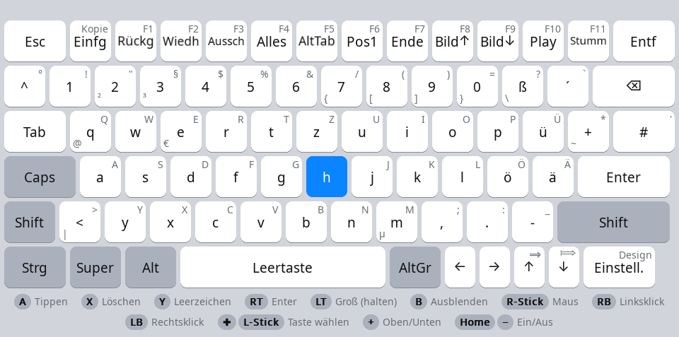
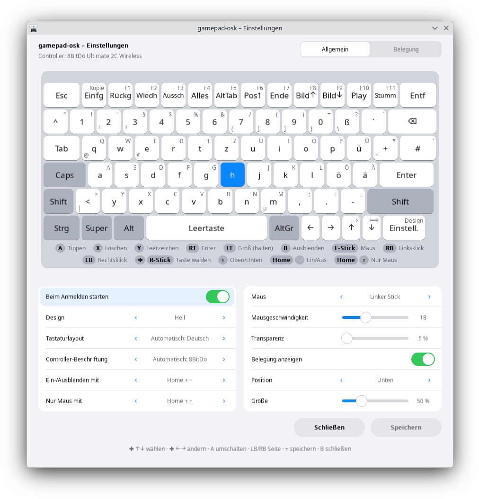
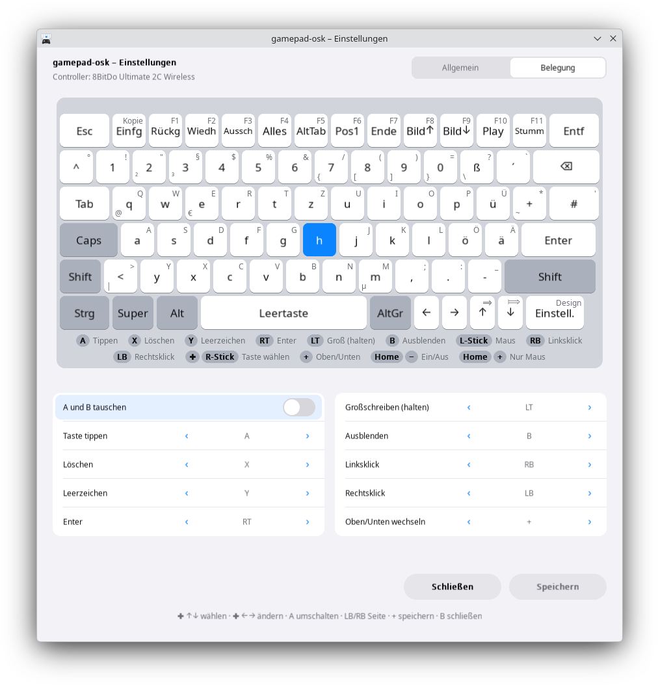
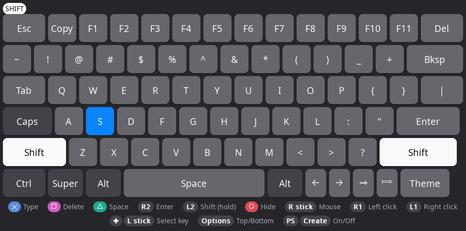
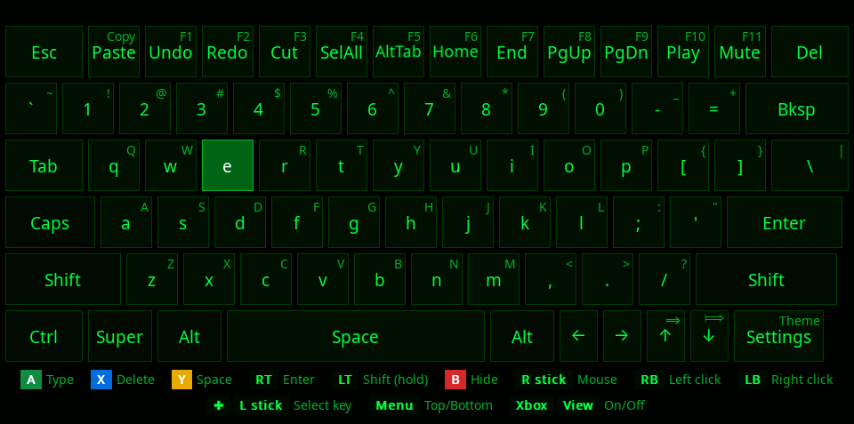

# gamepad-osk (TechnikWeber fork)

<p>
  <a href="https://github.com/TechnikWeber/gamepad-osk/releases/latest"></a>
  
  
  
  <a href="LICENSE"></a>
</p>

<p>
  <a href="#install"><b>Install</b></a> &nbsp;·&nbsp;
  <a href="#controls"><b>Controls</b></a> &nbsp;·&nbsp;
  <a href="#settings-window"><b>Settings</b></a> &nbsp;·&nbsp;
  <a href="https://technikweber.github.io/2026/gamepad-osk-mit-dem-controller-tippen/"><b>Blog post (German)</b></a> &nbsp;·&nbsp;
  <a href="https://github.com/0x90shell/gamepad-osk"><b>Original project</b></a>
</p>

Type on your Linux desktop with a game controller: an on-screen keyboard that
appears with a button combo, moves the mouse with a stick and gets out of the
way again. No Steam needed. Works on X11 and Wayland.

This is a fork of **[gamepad-osk by 0x90shell](https://github.com/0x90shell/gamepad-osk)**.
All the hard parts (evdev input, uinput typing, Wayland layer-shell, grab
handling, 60 themes) come from there. This fork adds a friendly default look,
a button legend, controller profiles, a German layout and a one-line install.



## What is new in this fork

* **Settings window** with live preview: theme, layout, controller, A/B swap,
  show/hide combo, mouse, size, transparency and *start at login* with one
  click. A second page puts every function on the button you want. Works
  with the controller, the mouse or the keyboard.
* **Mouse mode** (Guide + Start): the keyboard stays hidden, only a small
  mouse badge sits at the bottom centre. Stick = cursor, A = click, the
  other stick scrolls, the d-pad sends arrow keys, B ends it.
* **Transparency that works on Wayland** (window opacity has no effect on
  layer surfaces there), and the keyboard is **click-through**: mouse clicks
  reach the window behind it.
* **Light theme by default.** Rounded white keys, soft shadow, blue focus,
  like a phone keyboard. `night` is the same in dark. All 60 original themes
  stay, the original look is `theme = matrix`.
* **Button legend** under the keys: *A Type · X Delete · RT Enter …*, in the
  names printed on *your* controller. German or English, from the locale.
* **Controller profiles:** Xbox, PlayStation (✕ ○ □ △, L1/R2 …), Nintendo
  (B at the bottom, ZL/ZR, − +), 8BitDo and generic. Detected from driver,
  vendor and name. **Swap A and B** for pads where it feels the wrong way round.
* **8BitDo and other DInput pads over Bluetooth** work: right stick, and
  holding LT for capitals (digital triggers). Upstream read the right stick
  as triggers on these pads.
* **German QWERTZ layout** with ä ö ü ß, AltGr symbols (@ € { [ ] } \ ~ |)
  and correct Ctrl+Z / Ctrl+Y. Chosen automatically from the desktop layout
  (KDE, GNOME, localectl).
* **Fonts via fontconfig** with fallbacks for arrows and symbols. No more
  *no suitable font found* on Fedora and other distributions.
* **One-line install** without root on most desktops, autostart included,
  show/hide combo (Guide + Select) on by default.



## Install

```bash
curl -fsSL https://raw.githubusercontent.com/TechnikWeber/gamepad-osk/main/install.sh | bash
```

The script

* puts the binary into `~/.local/bin` (x86_64),
* installs SDL3 and SDL3_ttf with your package manager if they are missing (asks first),
* adds a udev rule only if your system gives no access to `/dev/uinput` (asks first),
* starts gamepad-osk hidden at every login (systemd user service),
* adds **gamepad-osk Settings** to the start menu (right click: show/hide keyboard).

Then press **Guide + Select** on the controller (Xbox button + View,
PS button + Create, Home + −). Remove it with `install.sh --uninstall`.

<details>
<summary>Build from source</summary>

```bash
# Fedora
sudo dnf install golang SDL3-devel SDL3_ttf-devel libX11-devel wayland-devel wayland-protocols-devel
# Debian 13+ / Ubuntu 25.04+
sudo apt install golang-go libsdl3-dev libsdl3-ttf-dev libx11-dev libwayland-dev wayland-protocols
# Arch
sudo pacman -S go sdl3 sdl3_ttf libx11 wayland wlr-protocols

git clone https://github.com/TechnikWeber/gamepad-osk.git
cd gamepad-osk
go build -o gamepad-osk .
./install.sh --local ./gamepad-osk
```
</details>

## Controls

The legend under the keys always shows the current mapping. Defaults, with
Xbox names:

| Button | Does |
|---|---|
| Guide + Select | show / hide |
| Guide + Start | mouse mode: keyboard hidden, small mouse badge |
| A | type the highlighted key (hold on a vowel: é, è, ñ …) |
| X / Y | backspace / space |
| LT (hold) / RT | capitals / Enter |
| B | hide |
| right stick | mouse; RB or stick click = left click, LB = right click |
| left stick, d-pad | move between keys |
| Start | keyboard top / bottom |

**Mouse mode:** stick moves the cursor, A or RB = left click, LB = right
click, the other stick scrolls, d-pad = arrow keys, B ends mouse mode,
Guide + Select switches to the keyboard.


While the keyboard is **hidden** it reads only the two combos: no mouse,
no grab. Games keep the controller to themselves (e.g. Minecraft with
Controlify). While it is visible it grabs the controller so input does not
reach the game.

## Settings window

Start menu → **gamepad-osk Settings**, `gamepad-osk --settings`, or the
**Settings** key on the keyboard itself (Shift + Settings cycles themes).



D-pad up/down selects, left/right changes, A toggles, LB/RB switch between
the pages *General* and *Buttons*, Start saves, B closes. On *Buttons* every
function gets the button you choose; a button that is already taken swaps
with it. Saving restarts the running keyboard so changes apply at once.



## Settings file

`~/.config/gamepad-osk/config`, created on the first start. The new keys:

```ini
[theme]
name = light          # light, night, matrix, nord, ... (Design/Cfg key cycles)

[window]
legend = true         # button legend under the keys
opacity = 0.95        # 0.2-1.0, now also on Wayland

[keys]
layout = auto         # auto, us (QWERTY), de (QWERTZ)

[gamepad]
controller = auto     # auto, xbox, playstation, nintendo, 8bitdo, generic
swap_ab = false       # true: A and B trade places
toggle_combo = guide+select
mouse_combo = guide+start   # mouse mode, empty = off
mouse_stick = right   # left or right

[gamepad.buttons]
position_toggle = start     # any function can be empty = off

[mouse]
sensitivity = 18      # new default (was 10)
```

Everything else (button mapping, size, opacity, key repeat …) is described
in the [original documentation](docs/UPSTREAM-README.md). Changed values
take effect after `systemctl --user restart gamepad-osk`.





## Screenshots without a display

```bash
gamepad-osk --layout de --controller nintendo --theme light --cursor 3,6 --screenshot shot.bmp
```

renders the keyboard off-screen. All pictures here are made that way.

## Credits and license

[gamepad-osk](https://github.com/0x90shell/gamepad-osk) © 2026 0x90shell,
MIT license. Fork changes © 2026 Philipp Weber, same license. See
[LICENSE](LICENSE).
